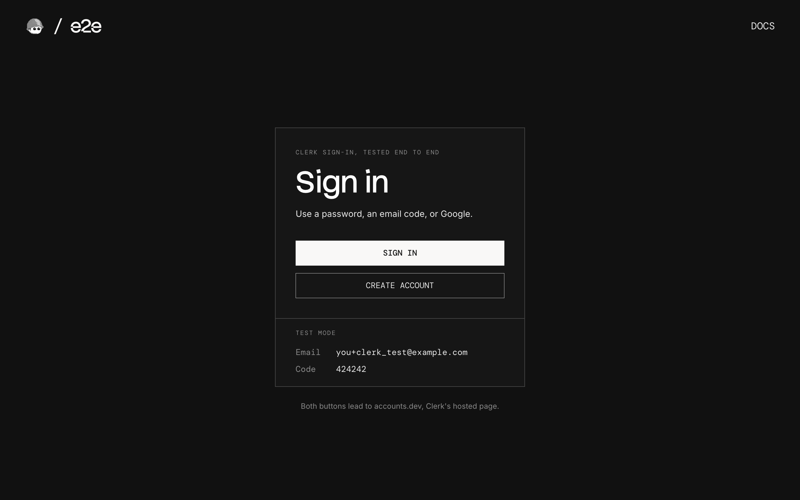

# e2e-clerk

A Next.js app that signs users in on Clerk's hosted pages, used as an example of end-to-end testing a sign-in page you don't own with [e2e](https://www.npmjs.com/package/e2e).



## How it works

Sign-in and sign-up happen on Clerk's Account Portal, the hosted pages every Clerk app comes with:

- **Home** (`app/page.tsx`) has Sign in and Create account. Clerk's `<SignInButton>` and `<SignUpButton>` wrap our buttons and send you to Clerk.
- **Clerk's page** (`<your-app>.accounts.dev`) signs you in with a password, an email code, or Google, and signs you up.
- **Account page** (`app/account/page.tsx`) reads the user and the session from Clerk on the server. `auth.protect()` sends a signed-out visitor to Clerk and back.

There is no database: Clerk holds the users and sessions. `proxy.ts` runs Clerk's middleware.

### Test mode

| Input                          | Value                                                                                  |
| ------------------------------ | -------------------------------------------------------------------------------------- |
| Any address with `+clerk_test` | Gets no email, e.g. `you+clerk_test@example.com`                                       |
| Verification code              | `424242`, for sign-up, email-code sign-in, and the code Clerk asks for on a new device |
| Test user                      | `ada+clerk_test@example.com` with `CLERK_TEST_PASSWORD`, created by the first test run |

Clerk's development instances are in test mode by default, so no email is ever sent.

## Getting started

```bash
npm install
npm run dev
```

Open [http://localhost:3000](http://localhost:3000).

### Clerk keys

Create a free app at [dashboard.clerk.com](https://dashboard.clerk.com). On its **User & authentication** page, turn on Email (with the verification code, not the link), Password, and Google, and turn off Phone.

Copy `.env.example` to `.env.local` and add the development keys (`pk_test_…` and `sk_test_…`) from the **API keys** page, or let Clerk's CLI write them:

```bash
npx clerk@latest auth login
npx clerk@latest env pull --app <your app id>
```

## End-to-end tests

The tests sign in on Clerk's real page. `tests/auth.setup.e2e.ts` signs in once with a password and saves the session, so the tests that need a signed-in user start signed in. The password is a `credentials` handle: e2e types it, and the model never sees it.

`tests/auth.e2e.ts` covers the account and home pages when signed in, a wrong password, an email code from a protected page, the handoff to Google, sign-up, and sign-out. Our pages are checked with exact locators, and Clerk's page with `agent.act` and `agent.waitFor` steps. Afterwards, each test asks Clerk's Backend API what happened: the session is active, the failed attempt was counted, the new user exists, the session ended. Users the tests create are deleted afterwards.

Two things Clerk does that the tests handle:

- **Bot protection** blocks sign-ups from an automated browser. The sign-up test adds a [Testing Token](https://clerk.com/docs/guides/development/testing/overview) to Clerk's requests, as `@clerk/testing` does for Playwright. Sign-in is never challenged.
- **Device Trust** asks for an email code when you sign in with a password on a new browser, which a test browser always is. It's on for apps created after November 14, 2025.

Clerk's page isn't built for automation, so a failed test on it runs up to two more times. The tests don't sign in to Google itself: Google refuses automated browsers.

Set `CLERK_TEST_PASSWORD` (at least 15 characters) and `AI_GATEWAY_API_KEY` for the agent's model through the Vercel AI Gateway (or link a Vercel project). Then, with the dev server running:

```bash
npm run test:e2e
```

To test a different URL, set `APP_URL`. Configuration lives in `e2e.config.ts`.

## Scripts

| Command            | Description          |
| ------------------ | -------------------- |
| `npm run dev`      | Start the dev server |
| `npm run build`    | Build for production |
| `npm run lint`     | Run ESLint           |
| `npm run format`   | Format with Prettier |
| `npm run test:e2e` | Run the e2e tests    |
